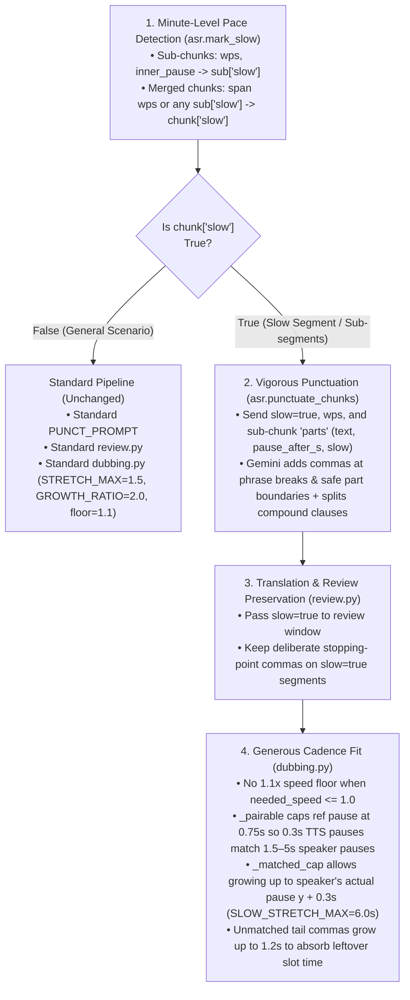

# Slow-Speaker Vigorous Punctuation & Generous Cadence Stretching Plan

## Goal Description

When a speaker talks very slowly or pauses for several seconds mid-sentence while writing on a slide/board (as in the latest run `0caec4b4bad944cb96bec3ec4a94d8cb`, *"W2L5: Generative Modelling via variational Divergence Minimization"*, and `854b91c566ce4839ae64a3df61a31ebd`), two things happen in the current pipeline:

1. **Too few stopping points in the transcript**:
   - [`cuts.check_cuts`](file:///data1/pratyaymishra_data/genai_proj2/backend/cuts.py#L233-L294) joins cuts across mid-sentence silences (including 0.5–5.1s pauses) so broken clauses aren't translated in isolation.
   - [`asr.merge_chunks`](file:///data1/pratyaymishra_data/genai_proj2/backend/asr.py#L162-L204) joins those pieces with plain spaces, and [`asr.punctuate_chunks`](file:///data1/pratyaymishra_data/genai_proj2/backend/asr.py#L211-L276) sends only `{id, speaker, text, editable}` to `google/gemini-3.5-flash-lite` with no timing or sub-segment pause info.
   - Gemini punctuates lightly (e.g., **0 commas** in Chunk 2's 13.2s span and **1 comma** in Chunk 3's 36.7s span in `0caec4b4`), so the translated text and TTS audio have almost no internal pauses (`tpauses`).

2. **Cadence fitting in [`dubbing.py`](file:///data1/pratyaymishra_data/genai_proj2/backend/dubbing.py) refuses to pair with or stretch across long pauses**:
   - **Pairing bottleneck ([`_pairable`](file:///data1/pratyaymishra_data/genai_proj2/backend/dubbing.py#L596-L599))**: requires `q["dur"] >= MATCH_MIN_RATIO * o["dur"]` (`0.4 * o["dur"]`). Since a natural TTS comma/period pause is `0.25–0.60 s`, **no TTS pause can ever pair with an original pause $> 1.0\text{–}1.5\text{ s}$** (e.g., in `854b91c5` Chunk 1, a `0.42 s` TTS pause at `p=0.34` was blocked from pairing with the speaker's `1.60 s` pause at `p=0.35` because `0.42 < 0.4 * 1.60 = 0.64`).
   - **Stretch cap bottleneck ([`_matched_cap`](file:///data1/pratyaymishra_data/genai_proj2/backend/dubbing.py#L607-L611))**: because each merged chunk is fitted as a single unit (`boundary=False`), `_matched_cap` caps every internal matched pause at **both** `STRETCH_MAX = 1.5 s` **and** `max(x + GROWTH_SLACK_S, GROWTH_RATIO * x)` (`max(x + 0.30, 2.0 * x)`). A `0.35 s` TTS comma pause is therefore capped at **`0.70 s`**, even when paired with a `3.0 s` or `5.1 s` speaker pause.
   - **Unmatched tail pauses ([`_cadence_fill`](file:///data1/pratyaymishra_data/genai_proj2/backend/dubbing.py#L541-L552))**: capped at `UNMATCHED_STRETCH_MAX_S = 0.30 s` with weight `0.05`.
   - **Speed floor ([`build_speed_dub`](file:///data1/pratyaymishra_data/genai_proj2/backend/dubbing.py#L150-L152))**: if *any* fast chunk in the run needs $> 1.35\times$, `SPEED_FLOOR = 1.1` speeds up even slow chunks whose TTS is already shorter than their slot (`needed_speed == 1.0`), widening the `end_gap`.

---

## Strategy Overview (Fixing Slow Segments Without Breaking General Scenarios)



Why this does **not** break dubbing in general scenarios:
- Every relaxation in `asr.py`, `review.py`, and `dubbing.py` is **gated on `c.get("slow")`** (or bounded by the speaker's actual pause length `y`).
- Normal-paced chunks (`wps > 2.2` and no slow sub-chunks, such as in `001ece32`, `ef99cc50`, `daf40f5f`) take the exact same code path and constants (`STRETCH_MAX = 1.5`, `GROWTH_RATIO = 2.0`, `UNMATCHED_STRETCH_MAX_S = 0.30`, `SPEED_FLOOR = 1.1`) as today.
- Even within a slow chunk, a matched pause never stretches to an arbitrary number: its cap is `min(max(x, y) + MATCHED_PAUSE_SLACK_S, SLOW_STRETCH_MAX)`, meaning it only grows to the **original speaker's actual pause duration `y`** (+ `0.30 s` slack, up to `6.0 s`). A `0.6 s` speaker pause still caps at `0.9 s`; only a `3.0 s` or `5.1 s` speaker pause can stretch to `3.3 s` or `5.4 s`.

---

## Proposed Changes

### 1. Slow Segment & Sub-segment Identification + Vigorous Punctuation (`backend/asr.py`)

#### [MODIFY] [asr.py](file:///data1/pratyaymishra_data/genai_proj2/backend/asr.py)

1. **Add pace constants**:
   ```python
   SLOW_WPS = 2.2  # words/s at or below which a merged chunk or a sub-chunk counts as slow
   SLOW_MIN_DUR_S = 1.5  # a sub-chunk without a long pause after it needs at least this duration to count as slow by wps alone
   SLOW_PAUSE_S = 1.0  # an internal pause at least this long inside a merged chunk also marks the sub-chunk before it as slow
   ```

2. **Add `mark_slow(chunks: list[dict])`** (called at the end of `merge_chunks` and at the start of `punctuate_chunks` if `"slow"` is not yet on `chunks`):
   - For each merged chunk `c` and its non-empty `sub_chunks` `subs`:
     - For each `k, s` in `enumerate(subs)`:
       - `dur = max(float(s["end"] - s["start"]), 1e-3)`
       - `words = len((s.get("text_raw") or s.get("text") or "").split())`
       - `wps = round(words / dur, 2)`
       - `gap = round(float(subs[k + 1]["start"] - s["end"]), 3) if k + 1 < len(subs) else None`
       - `s["wps"] = wps`
       - `s["slow"] = bool(words and ((dur >= SLOW_MIN_DUR_S and wps <= SLOW_WPS) or (gap is not None and (gap >= SLOW_PAUSE_S or words / max(dur + gap, 1e-3) <= SLOW_WPS))))`
     - For the merged chunk `c`:
       - `span = max(float(c["end"] - c["start"]), 1e-3)`
       - `total_words = len((c.get("text_raw") or c.get("text") or "").split())`
       - `c["wps"] = round(total_words / span, 2)`
       - `c["slow"] = bool(total_words and (c["wps"] <= SLOW_WPS or any(s.get("slow") for s in subs)))`

3. **Pass `slow`, `wps`, and `parts` to Gemini Flash-Lite in `_punctuate_window`**:
   - Helper `_punct_item(c: dict, is_editable: bool) -> dict`:
     - Starts with `{"id": c["id"], "speaker": c["speaker"], "text": c["text"], "editable": is_editable}`.
     - If `is_editable and c.get("slow")`:
       - Adds `"slow": True, "wps": c.get("wps")`.
       - If `len(subs) > 1`, adds `"parts"`:
         ```python
         [
             {
                 "text": (s.get("text_raw") or s["text"]).strip(),
                 "wps": s.get("wps"),
                 "pause_after_s": round(float(subs[k + 1]["start"] - s["end"]), 2) if k + 1 < len(subs) else None,
                 "slow": bool(s.get("slow")),
             }
             for k, s in enumerate(subs)
         ]
         ```

4. **Update `PUNCT_PROMPT` in `backend/asr.py`**:
   - Add the slow-speech punctuation rule under item `2. Punctuation`:
     ```
        - Slow speech (editable segments with slow=true, or sub-segments in "parts" with slow=true or a pause_after_s):
          the speaker is talking very slowly or pausing mid-sentence (e.g. while writing on a board), and the dub
          needs extra stopping points so text-to-speech pauses with the speaker instead of rushing ahead. Punctuate
          these vigorously:
          (a) Put a comma (",") at every cut between "parts" where a pause can stand without breaking a tight
              two-word unit (never split a determiner, preposition or auxiliary directly from its bare noun or verb
              like "the, model" or "of, x", but DO put commas after clauses, prepositional phrases, long subjects,
              verb phrases before their complements, conjunctions, and mathematical expressions).
          (b) Inside any slow segment or slow part, add commas at every natural phrase boundary (after introductory
              or discourse words like "Now,", "So,", "And,", between coordinate phrases, and around prepositional or
              adverbial phrases).
          (c) Where a slow segment joins two complete clauses with "and", "so", "but" or "then", split them into
              separate sentences with a sentence-ending mark ("." / "।") instead of a comma.
     ```

5. **Record slow counts in `info["punctuation"]`**:
   - Include `"slow_chunks"` and `"slow_sub_chunks"` in the stats dict returned by `punctuate_chunks`.

---

### 2. Preserve Slow-Segment Stopping Points in Review (`backend/review.py`)

#### [MODIFY] [review.py](file:///data1/pratyaymishra_data/genai_proj2/backend/review.py)

- In `_review_window`, include `"slow": bool(c.get("slow"))` in each segment item sent to Gemini Flash-Lite.
- In `PROMPT`, update the `- punctuation:` bullet:
  ```
  - punctuation: missing, wrong or excessive punctuation that would make the speech pause in the wrong place.
    Segments with slow=true intentionally have extra commas and sentence breaks so the dub pauses with a slow
    speaker: keep those stopping points in the translation (only fix a mark that breaks a tight two-word unit).
  ```

---

### 3. Generous Cadence Stretching for Slow Segments (`backend/dubbing.py`)

#### [MODIFY] [dubbing.py](file:///data1/pratyaymishra_data/genai_proj2/backend/dubbing.py)

1. **Add slow-cadence constants** (alongside existing constants, keeping all normal constants identical):
   ```python
   SLOW_STRETCH_MAX = 6.0  # in a slow segment (c["slow"]), a matched pause may grow up to the original pause + slack, capped at this
   SLOW_MATCH_REF_MAX_S = 0.75  # in a slow segment, _pairable caps o["dur"] at this when checking MATCH_MIN_RATIO, so a 0.3 s TTS comma pause can pair with a multi-second speaker pause
   SLOW_PROGRESS_TOLERANCE = 0.16  # wider progress window for slow multi-part segments
   SLOW_UNMATCHED_STRETCH_WEIGHT = 0.25  # in a slow segment, unmatched TTS pauses in the tail absorb more leftover time ...
   SLOW_UNMATCHED_STRETCH_MAX_S = 1.20  # ... up to this cap
   ```

2. **Speed floor exemption in `_fit_one`**:
   - If `c.get("slow") and plan["needed"] <= 1.0`, use `eff_floor = 1.0` instead of `floor` (`1.1x`), so a slow segment whose TTS is already shorter than its slot is never sped up to `1.1x`.

3. **Slow-aware pause pairing and stretching in `_cadence_plan` and `_cadence_fill`**:
   - In `_cadence_plan([c], ...)`:
     - `slow = bool(u[0].get("slow"))`
     - `tol = SLOW_PROGRESS_TOLERANCE if slow else PROGRESS_TOLERANCE`
     - Pass `slow=slow` into `_cadence_match` and `_pairable`, and store `"slow": slow` in `plan`.
   - In `_pairable(q, o, tol=PROGRESS_TOLERANCE, slow=False)`:
     ```python
     ref = min(o["dur"], SLOW_MATCH_REF_MAX_S) if slow else o["dur"]
     return _progress_diff(q, o) <= tol and q["dur"] >= MATCH_MIN_RATIO * ref
     ```
   - In `_matched_cap(x, y, boundary=True, slow=False)`:
     ```python
     cap = min(max(x, y) + MATCHED_PAUSE_SLACK_S, SLOW_STRETCH_MAX if slow else STRETCH_MAX)
     if boundary or slow:
         return cap
     return min(cap, max(x + GROWTH_SLACK_S, GROWTH_RATIO * x))
     ```
     - When `slow=True`, a matched TTS pause can grow up to `max(x, y) + 0.30s` (bounded by the speaker's actual pause `y` + `0.30s`, up to `6.0s`), without being choked at `2.0 * x` (`~0.70s`) or `1.5s`.
   - In `_cadence_fill` Step 3 (tail fill after the last anchor):
     - Use `SLOW_UNMATCHED_STRETCH_WEIGHT` (`0.25`) and `SLOW_UNMATCHED_STRETCH_MAX_S` (`1.20s`) when `plan.get("slow")` is `True`, else `UNMATCHED_STRETCH_WEIGHT` (`0.05`) and `UNMATCHED_STRETCH_MAX_S` (`0.30s`).

---

### 4. Studio State & Pipeline Docs (`backend/studio.py`, `pipeline.md`)

#### [MODIFY] [studio.py](file:///data1/pratyaymishra_data/genai_proj2/backend/studio.py)
- Add `"wps"` and `"slow"` to `MERGED_KEYS` and clear them on `redo` in `_asr_step`.
- Expose `"wps": c.get("wps")` and `"slow": bool(c.get("slow"))` in `_segments(chunks)`.

#### [MODIFY] [pipeline.md](file:///data1/pratyaymishra_data/genai_proj2/pipeline.md)
- Document `asr.mark_slow`, the new constants (`SLOW_WPS`, `SLOW_MIN_DUR_S`, `SLOW_PAUSE_S`, `SLOW_STRETCH_MAX`, `SLOW_MATCH_REF_MAX_S`, `SLOW_PROGRESS_TOLERANCE`, `SLOW_UNMATCHED_STRETCH_WEIGHT`, `SLOW_UNMATCHED_STRETCH_MAX_S`), the `wps`/`slow` chunk/sub-chunk fields, the `parts` payload in `punctuate_chunks`, the `slow` preservation in `review.py`, and the slow-segment cadence rules in Stage 2, Stage 3, and Stage 4.

---

## Verification Plan

### Automated Verification
1. **Slow-detection check across all stored runs**:
   - Run `asr.mark_slow` on `0caec4b4bad944cb96bec3ec4a94d8cb` (slow lecture), `854b91c566ce4839ae64a3df61a31ebd` (slow lecture), `001ece3256c2487ca2d1afd907e74447` (normal lecture), `ef99cc505ceb4b88b5138aa079e08444` (normal lecture), and `daf40f5f1dcb43e1b50a8e8d09e296c2` (multi-speaker dialogue).
   - Verify slow chunks/sub-chunks in `0caec4b4` and `854b91c5` are flagged while normal chunks remain `slow=False`.
2. **Vigorous punctuation dry-run on `0caec4b4bad944cb96bec3ec4a94d8cb`**:
   - Run `asr.punctuate_chunks` on a scratch copy of `0caec4b4bad944cb96bec3ec4a94d8cb`'s merged chunks and verify that Chunks 0–5 gain natural comma/sentence stopping points at their slow parts and pause cuts, while passing `_light_edit`.
3. **Cadence fit check on `854b91c566ce4839ae64a3df61a31ebd` & normal runs**:
   - Verify on `854b91c5` that slow chunks stretch across the `1.48–1.70s` speaker pauses and reduce `end_gap` (`2.17s -> < 0.9s` even before re-punctuating), and verify on `001ece32` that normal chunks produce identical `dub` metrics (zero regression).
